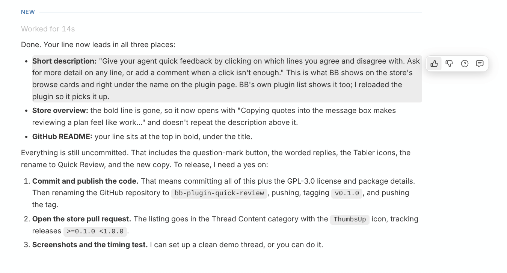
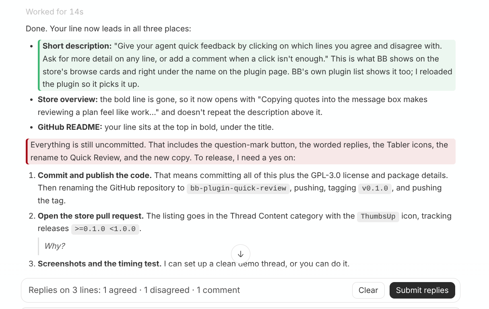

# Quick Reply for BB

**Give your agent quick feedback by clicking on which lines you agree and disagree with.**



Copying quotes into the message box makes reviewing a long reply feel like
work. Replying "looks good" saves typing, but leaves the agent guessing which
details you actually approved.

Quick Reply puts the buttons on the reply. Hover a line, click agree,
disagree or "tell me more", move to the next one. Press **Submit replies**
when you're done. Nothing to type unless you want to add a comment.

The agent gets one ordinary message from you, each line you clicked quoted
with your verdict under it in plain words:

```
My replies, line by line:

> Use Postgres for the job queue
Agreed.

> Retry failed jobs 5 times with exponential backoff
Disagreed.

> Add a dead-letter queue
Please explain this in more detail.
```

The agent is never told the plugin exists. Quick Reply adds no skill,
command or tool to agent threads, and the message reads like one you wrote.

## Using it

- **Hover any line** of an agent's reply. Four buttons appear beside it:
  thumbs-up (agree), thumbs-down (disagree), question mark (ask the agent to
  explain that line in more detail) and speech bubble (comment).
- **Click a verdict.** The line gets a green, red or amber edge. A line holds
  one verdict; click another to change it, or the same one again to take it
  back.
- **Comment only when a click isn't enough.** The speech bubble opens a box;
  Enter saves, Shift+Enter starts a new line, Esc cancels. A comment can go
  with any verdict ("Disagreed: 3 retries is enough") or stand alone.
- **Send.** A bar above the message box counts what you marked. **Submit
  replies** sends it at once, or queues it if the agent is still working.
  Anything you had already typed in the message box goes along, with the
  replies after it. **Clear** drops every mark in the thread.



What counts as a line: each paragraph, list item, table row (not the header)
and code block. Headings and horizontal rules get no controls. A list item
with a nested list is one line for its own text; the nested items are lines
of their own.

Marks are saved in this BB window's local storage per thread, so switching
threads, scrolling and reloading BB keep them. Marks untouched for 30 days
are dropped.

## How it works

| File | Role |
| --- | --- |
| `content.ts` | Content script. Finds agent replies on the page, tags each line with `data-lr-*` attributes, and draws the floating toolbar and comment box. |
| `lib/lines.ts` | Splits a rendered reply into lines. |
| `lib/marks.ts` | The marks store, shared by the content script and the bar, kept in localStorage. |
| `lib/format.ts` | Builds the message sent to the agent. |
| `lib/icons.ts` | The four toolbar icons, from [Tabler Icons](https://tabler.io/icons) (MIT). |
| `app.tsx` | Registers the content script and the bar above the message box (a composer banner), which sends through BB's composer API. |
| `app.css` | Styles, built from BB's theme variables. |
| `server.ts` | Empty backend, required by BB. |

### Depends on BB's page layout

BB has no plugin slot inside ordinary replies, so the content script reads
the chat page directly. It relies on three things observed on bb 0.46:

- each timeline row has `data-timeline-row-id`, and agent messages contain
  `:assistant:` in it, after the thread id and a `:`;
- a reply's Markdown is inside `[data-markdown-preview]`;
- the chat scroll area is `[data-page-scroll-viewport]`.

If a BB update changes these, the controls stop appearing. Nothing else
breaks, and saved marks are kept. Sending uses BB's official composer API and
is not affected.

## Install

From BB's plugin store: search for **Quick Reply**. Or from a terminal:

```
bb plugin install git:https://github.com/mturilin/bb-plugin-quick-reply.git
```

Requires BB 0.46 or later. Nothing else to install, no account, no external
service: marks stay in your BB window until you send them, and the only thing
that leaves is the message you send to your own agent.

## Development

```
npm install
npm test            # unit tests (node --test, happy-dom)
npm run typecheck
bb plugin build
bb plugin install . # once; afterwards: bb plugin reload quick-reply
```

## License

GPL-3.0. The toolbar icons are from [Tabler Icons](https://tabler.io/icons),
MIT License.
